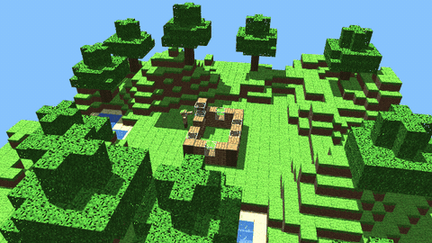
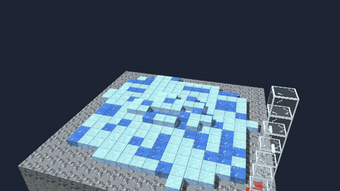

# voxel-animations

A Claude skill for blocky, voxel-style 3D scenes and animations: worlds built block by
block, pixel-art textures, a little builder character, explosions with bouncing blocks,
day/night with torches, and frame-exact video export (including transparent `.mov` for
editing).

| House builder | Melting crystal (physics) |
|---|---|
|  |  |

Everything is original: textures are generated in code at runtime, the character is an
original design, and no game assets are used. The only dependency is
[three.js](https://threejs.org) r128 from a CDN.

## Install

**Claude Code**

```bash
git clone https://github.com/normix93/voxel-animations ~/.claude/skills/voxel-animations
```

**Claude apps**: download this repo as a ZIP and upload it in Settings → Capabilities → Skills
(or the equivalent skills page in your app).

Then ask for things like:

- "Make a voxel animation of a lighthouse being built, ending at night with the light on"
- "Explain the greenhouse effect with a blocky scene, transparent background, 12 seconds"
- "Blocky intro for my channel: a logo assembled block by block, vertical 1080×1920"

## What's inside

```
SKILL.md                     instructions Claude follows
assets/voxel-kit.js          the kit (textures, terrain, character, camera, sky, effects, capture)
assets/template.html         starting page for new scenes
examples/house-builder.html  builder places a house, cheers, it explodes, loop
examples/melting-crystal.html  Lindemann melting of an ice lattice, with thermometer and puddle
src/                         example sources (with the <!-- VOXEL_KIT --> marker)
scripts/inline_kit.py        inline the kit into a page → one self-contained .html
scripts/render.py            frame-exact render → .mov (ProRes, alpha), .mp4, .webm or PNG frames
```

Open any file in `examples/` with a double click: drag to orbit, wheel to zoom, `H` hides
the UI, `V` records a quick WebM.

## Video export

```bash
pip install playwright && python3 -m playwright install chromium   # once; needs ffmpeg too
python3 scripts/render.py examples/house-builder.html --seconds 12 --out house.mov
python3 scripts/render.py examples/melting-crystal.html --seconds 20 --alpha --out crystal.mov
```

Each frame advances the scene by exactly `1/fps`, so videos are smooth even on a slow
machine. URL options for any page: `?clean`, `?alpha`, `?seed=3`, `?speed=2`, `?night`.

## The kit in 10 lines

```html
<script src="https://cdnjs.cloudflare.com/ajax/libs/three.js/r128/three.min.js"></script>
<script src="assets/voxel-kit.js"></script>
<script>
const app = VK.createApp({ title: 'HELLO BLOCKS', sky: 'day' });
const world = VK.island(app, { seed: 3 });
const hero = VK.character(app, { ground: world.groundTopAt, position: [4, 0, 4] });
let y = 1, t = 0;
app.onUpdate(dt => { if ((t += dt) > .4 && y < 10) { t = 0; VK.block(app, 'brick', 0, y++, 0, { pop: true }); } });
app.start();
</script>
```

## License

MIT © 2026 normix
